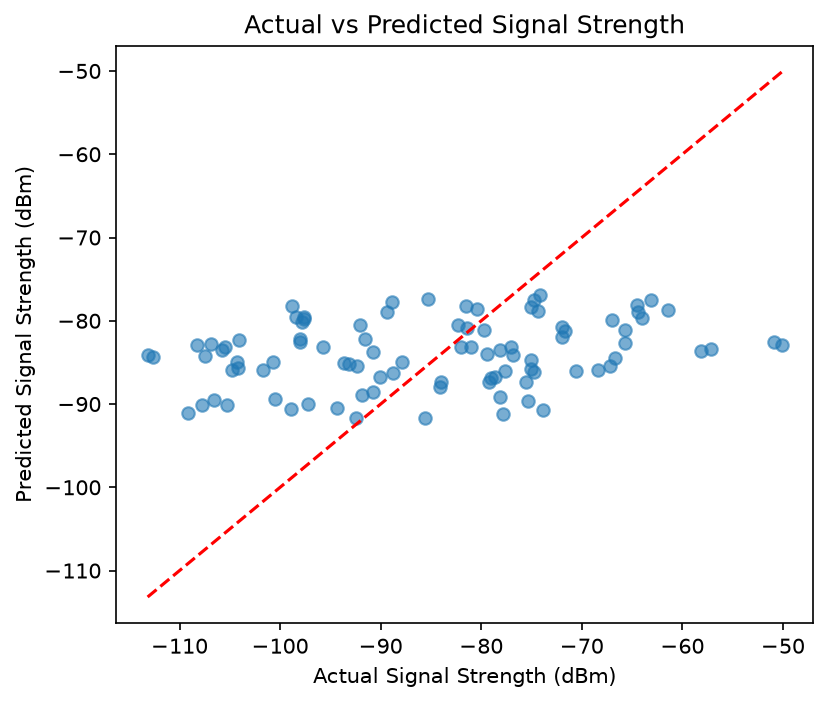
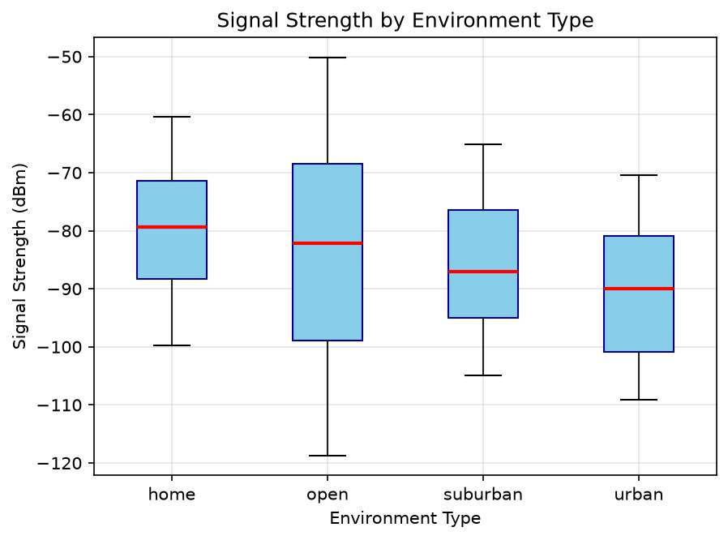

# Predicting Cellular Network Signal Strength Using Linear Regression

A machine learning project that predicts cellular network signal strength (dBm) using environmental and network-related parameters through Linear Regression.

## 1. Team and Roles

## 1. Team and Roles

| Team Member      | Role               | GitHub Username                                                |
| ---------------- | ------------------ | -------------------------------------------------------------- |
| Aadarsh Awlasiya | Execution Lead     | [@2026aib1004-ship-it](https://github.com/2026aib1004-ship-it) |
| Sumit            | Documentation Lead | [@2026mcb1574-pixel](https://github.com/2026mcb1574-pixel)     |
| Palak Tripathi   | Video lead         | [@PalakTripathi49](https://github.com/PalakTripathi49)         |
| Sumeksha         | PPT lead           | [@Sumeksha1](https://github.com/Sumeksha1)                     |


## 2. Project Structure

```text
Cellular-Network-Signal-Prediction/
│
├── data/
│
├── README.md
├── train.csv
├── linear-regression.ipynb
├── data_visualization.ipynb
├── requirements.txt
│
├── actual_vs_predicted.png
├── signal_vs_environment.png
│
└── testing_results.csv
```

## 3. Setup

### Prerequisites

- Python 3.10 or above
- Jupyter Notebook
- pip (Python package installer)
- Git (optional, for cloning the repository)

### Required Libraries

All required Python libraries are listed in `requirements.txt`.

To install the dependencies, run:

```bash
pip install -r requirements.txt
```

## 4. Steps to Run

Follow these steps in the given order to execute the project.

**Step 1: Clone the Repository**

```bash
git clone <repository-url>
```

**Step 2: Navigate to the Project Directory**

```bash
cd <repository-folder>
```

**Step 3: Install Dependencies**

```bash
pip install -r requirements.txt
```

**Step 4: Start Jupyter Notebook**

```bash
jupyter notebook
```

**Step 5: Run Data Visualization**

Open `data_visualization.ipynb` and execute all cells to explore the dataset and generate visualizations.

**Step 6: Run the Linear Regression Model**

Open `linear-regression.ipynb` and execute all cells in order to:

- Load and preprocess the dataset.
- Select input features and target variable.
- Split the dataset into training and testing sets.
- Train the Linear Regression model.
- Generate predictions.
- Calculate evaluation metrics.

## 5. Expected Output

After successfully executing the notebooks, the project produces:

- Actual vs Predicted Signal Strength visualization.
- Signal Strength vs Environment visualization.
- Predicted signal strength values.
- Model evaluation metrics.

### Model Evaluation Results

| Metric | Value |
|---|---:|
| MAE | 12.2973 |
| MSE | 210.4448 |
| RMSE | 14.5067 |
| R² Score | 0.0671 |

### Output Screenshots

**Actual vs Predicted Signal Strength**



**Signal Strength vs Environment**



## 6. Project Links

- **Presentation Slides:** [Add presentation link here]
- **Project Demonstration Video:** [Add video link here]

## 7. AI-Use Disclosure

ChatGPT was used as a supporting tool during this project for understanding machine learning concepts, debugging code, resolving errors, and improving documentation. The project implementation, model execution, result analysis, and final decisions were carried out and reviewed by the team.
